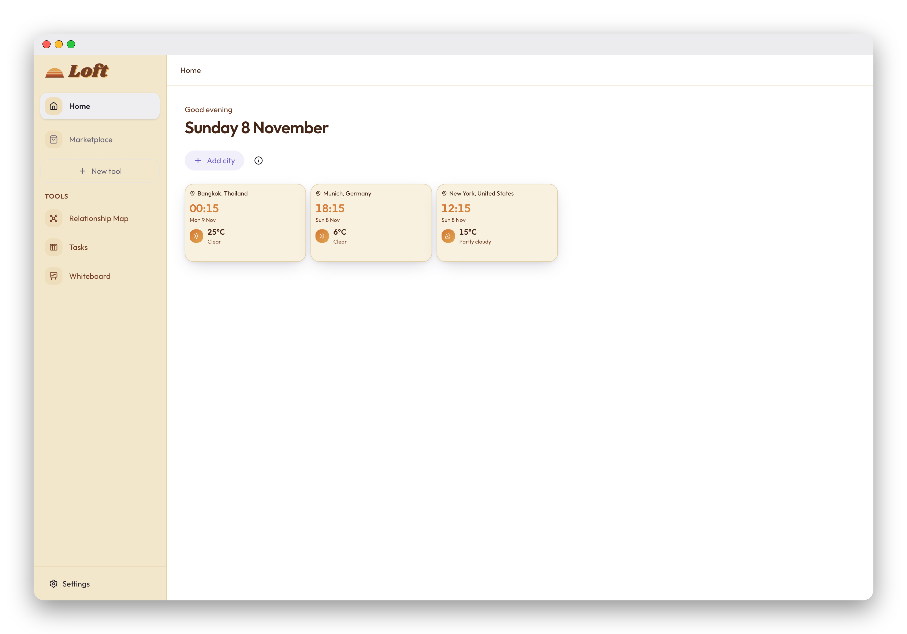
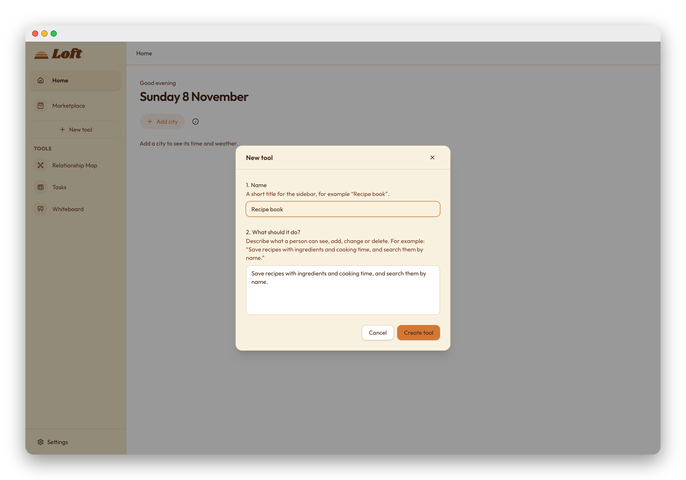
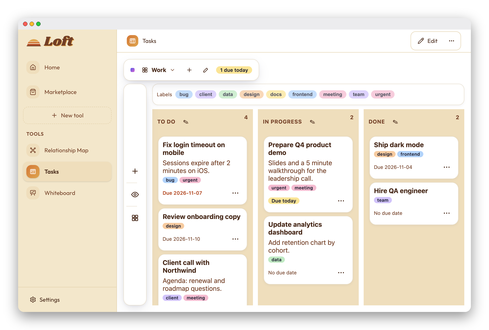
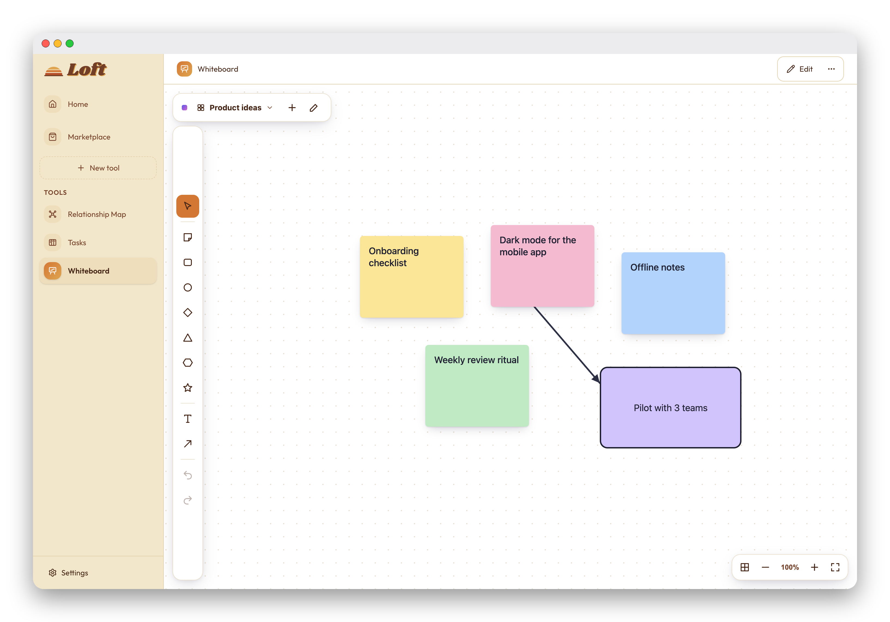
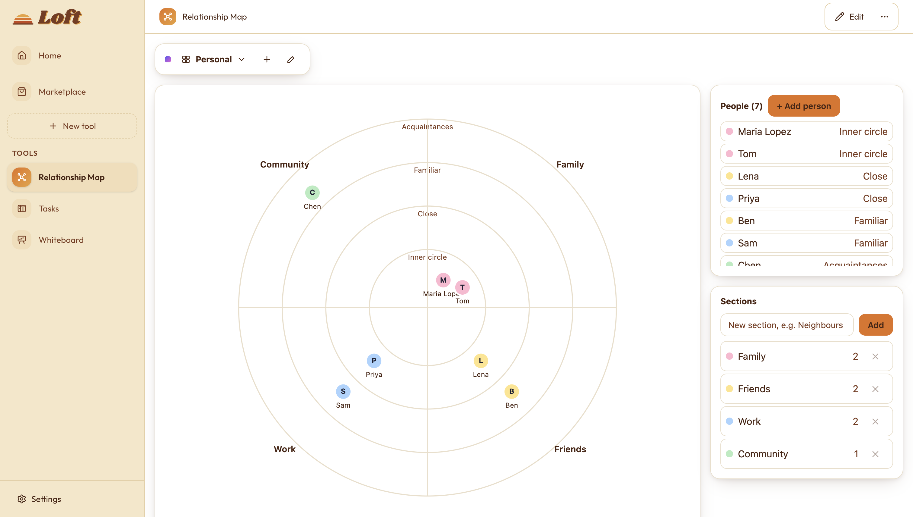
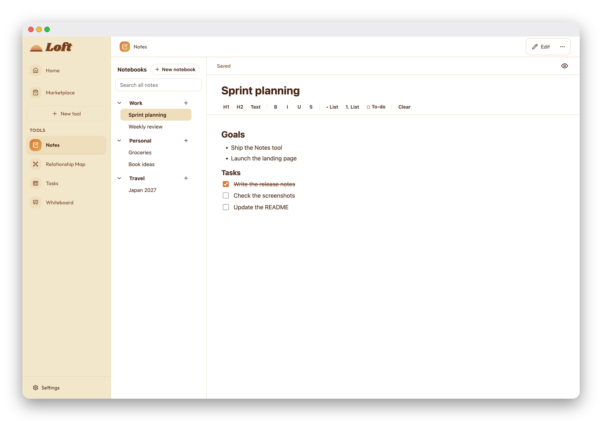
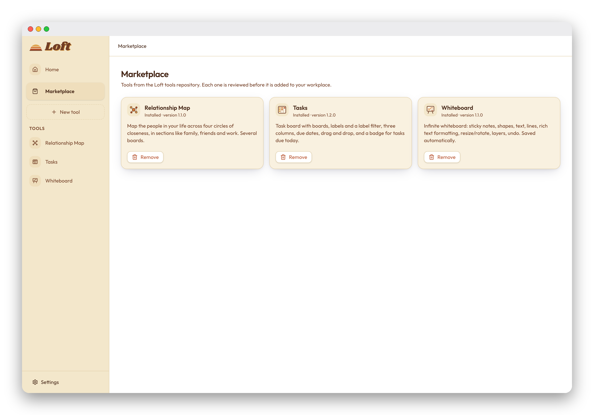

# Loft

Loft is a desktop app for small, personal tools. You describe a tool in plain language, Claude builds it, and it runs on your computer with its data kept locally. Tools you need are also available from a Marketplace.



## The idea

- **Everything is local.** Tools, their data and your settings live on your computer. Each tool has its own database file. Nothing is synced to a server, and there is no account.
- **Create your own tools with AI.** Give a name and describe what the tool should do, for example "Save recipes with ingredients and cooking time, and search them by name". Claude writes the tool, and you can keep refining it by describing changes.
- **Review before anything is added.** A generated tool or a Marketplace tool is shown to you first. Nothing is installed until you approve it.
- **Install from the Marketplace.** Tools built by others are listed in the [loft-tools](https://github.com/paul-wieland/loft-tools) repository. You can install, update and remove them from the Marketplace page.
- **Tools run in a sandbox.** Each tool runs in its own frame with a strict content security policy. It can only read and write its own data, and it can't reach other tools or the internet.

## Create a tool

Give the tool a name and describe what it should do. Claude writes it, and you review it before anything is installed.



## Built-in tools

These tools come from the Marketplace. Each one has its own sample screenshot below.

| Tool | What it does |
| --- | --- |
| Tasks | A task board with boards, labels, due dates, and drag and drop between columns |
| Whiteboard | An infinite canvas with sticky notes, shapes, text, lines and arrows |
| Relationship Map | People placed in four circles of closeness, grouped by section, with several boards |
| Notes | Notebooks with pages, rich text, checklists and a privacy mode that blurs the text |









## Marketplace

The Marketplace reads a public catalog from the `loft-tools` repository. Each tool lists its files with a SHA-256 checksum, and Loft checks every file before it is used. Installing a tool runs the same review as a generated tool.



## Privacy and data

- **Your tool data stays on your computer.** It is stored in a SQLite database for each tool. Before a tool's data is replaced, the last five snapshots are kept as backups.
- **Your Claude API key** is encrypted with the operating system's keychain (Electron `safeStorage`). Loft needs it to create and change tools.
- **What is sent to Anthropic:** when you create or change a tool, your description and the tool's source code are sent to the Claude API. Your tool data is never sent.
- **Network use:** the home page fetches time and weather from Open-Meteo for the cities you add. The Marketplace downloads the catalog and tool files from GitHub.

## Appearance

Loft has three appearance options in Settings: **Loft** (the default), **Classic white** and **Classic dark**. The Loft style uses the brand colours and the Shrikhand and Outfit fonts. The brand kit and tool artwork are in [`design-resources/loft-brand`](design-resources/loft-brand).

## Getting started

Requirements: Node.js 20 or newer and macOS (other platforms are not tested yet).

```bash
npm install
npm run dev        # start the app in development mode
```

Other commands:

```bash
npm run typecheck  # TypeScript check
npm test           # unit tests (Vitest)
npm run build      # build the app into out/
```

## Project layout

- `src/main`: Electron main process, the app's composition root
- `src/preload`: the bridge between the main process and the renderer
- `src/renderer`: the React interface
- `src/application`: use cases such as generating, approving and installing tools
- `src/domain`: core types and rules
- `src/infrastructure`: Electron, file system, SQLite, the Claude Agent SDK and GitHub access
- `specs`: design notes on the architecture, the generation flow, the package format and versioning
- `tests`: unit tests

## Tool package format

A tool is a folder with a `manifest.json`, a `schema.json` describing its collections, and a `ui/index.js` entry point. See [`specs/package-contract.md`](specs/package-contract.md) for the details.
